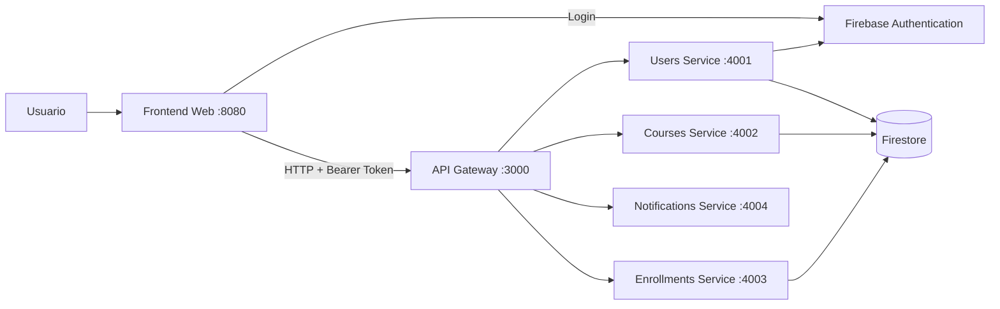

# Sistema de Gestión de Cursos

Sistema académico con arquitectura de microservicios para la administración de usuarios, cursos, matrículas y calificaciones. El acceso está segmentado por roles (administrador, docente y estudiante) y la autenticación se delega en Firebase.


---

## Tabla de contenido

1. [Descripción general](#descripción-general)
2. [Funcionalidades por rol](#funcionalidades-por-rol)
3. [Arquitectura](#arquitectura)
4. [Stack tecnológico](#stack-tecnológico)
5. [Estructura del proyecto](#estructura-del-proyecto)
6. [Requisitos previos](#requisitos-previos)
7. [Configuración](#configuración)
8. [Ejecución](#ejecución)
9. [API del Gateway](#api-del-gateway)
10. [Variables de entorno](#variables-de-entorno)
11. [Seguridad](#seguridad)
12. [Documentación adicional](#documentación-adicional)

---

## Descripción general

El proyecto separa la interfaz de usuario de la lógica de negocio:

- El **frontend** es una aplicación web estática (HTML, CSS y JavaScript modular) servida con `http-server`.
- El **API Gateway** centraliza las solicitudes en `http://localhost:3000` y las redirige al microservicio correspondiente.
- Cada **microservicio** expone una API HTTP independiente y se comunica con Firebase.
- **Firebase Authentication** gestiona las sesiones y los tokens.
- **Firestore** almacena usuarios, cursos, matrículas y calificaciones.

## Funcionalidades por rol

| Rol | Funcionalidades |
| --- | --- |
| **Administrador** | Crea cursos, registra usuarios, asigna roles y consulta la información del sistema. |
| **Docente** | Consulta sus cursos y estudiantes, y registra calificaciones. |
| **Estudiante** | Consulta cursos disponibles, se matricula y consulta sus calificaciones. |

## Arquitectura



| Componente | Puerto | Responsabilidad |
| --- | --- | --- |
| Frontend | `8080` | Interfaz por roles, login y consumo del Gateway. |
| API Gateway | `3000` | Punto de entrada único, enrutamiento y manejo de errores. |
| Users Service | `4001` | Usuarios, perfiles, roles y consulta de estudiantes. |
| Courses Service | `4002` | Creación y consulta de cursos. |
| Enrollments Service | `4003` | Matrículas y calificaciones. |
| Notifications Service | `4004` | Notificaciones y recordatorios (implementación en memoria). |

**Flujo de una solicitud:** el frontend obtiene un token de Firebase Authentication y lo envía en la cabecera `Authorization: Bearer <token>`. El Gateway reenvía la petición al servicio destino, que valida el token con Firebase Admin y opera sobre Firestore.

## Stack tecnológico

- **Runtime:** Node.js con ES Modules.
- **Backend:** Express 5, `cors`, `dotenv`, `firebase-admin`.
- **Frontend:** HTML5, CSS3, JavaScript modular, Firebase Web SDK.
- **Base de datos:** Cloud Firestore.
- **Autenticación:** Firebase Authentication (Email/Password).
- **Herramientas de desarrollo:** Nodemon y `http-server`.

## Estructura del proyecto

```text
Arquitectura MicroServicios/
├── README.md
├── respuestas-arquitectura.md
└── gestion-cursos/
    ├── .env.example
    ├── .gitignore
    ├── package.json
    ├── start-all.ps1
    ├── frontend/
    │   ├── index.html
    │   ├── register.html
    │   ├── package.json
    │   ├── assets/
    │   │   ├── icons/
    │   │   └── img/
    │   ├── css/
    │   │   ├── styles.css
    │   │   ├── base/
    │   │   │   ├── reset.css
    │   │   │   └── variables.css
    │   │   └── pages/
    │   │       ├── admin.css
    │   │       ├── docente.css
    │   │       ├── estudiante.css
    │   │       └── login.css
    │   ├── js/
    │   │   ├── auth/
    │   │   │   ├── authGuard.js
    │   │   │   ├── login.js
    │   │   │   └── register.js
    │   │   ├── config/
    │   │   │   ├── firebaseConfig.js
    │   │   │   └── firebaseConfig.example.js
    │   │   └── services/
    │   │       ├── apiClient.js
    │   │       ├── coursesApi.js
    │   │       ├── enrollmentsApi.js
    │   │       └── usersApi.js
    │   └── pages/
    │       ├── admin/
    │       │   ├── cursos.html
    │       │   ├── dashboard.html
    │       │   └── usuarios.html
    │       ├── docente/
    │       │   ├── calificar.html
    │       │   ├── dashboard.html
    │       │   └── mis-cursos.html
    │       └── estudiante/
    │           ├── curso-detalle.html
    │           ├── dashboard.html
    │           └── mis-cursos.html
    ├── services/
    │   ├── api-gateway/
    │   │   ├── index.js
    │   │   └── package.json
    │   ├── users-service/
    │   │   ├── index.js
    │   │   ├── package.json
    │   │   └── src/
    │   │       └── app.js
    │   ├── courses-service/
    │   │   ├── index.js
    │   │   └── package.json
    │   ├── enrollments-service/
    │   │   ├── index.js
    │   │   └── package.json
    │   └── notifications-service/
    │       ├── index.js
    │       └── package.json
    └── shared/
        └── firebase-admin-config/
            └── firebase.js
```

> Los archivos `.env`, `serviceAccountKey.json` y `firebaseConfig.js` contienen configuración local o credenciales y no deben versionarse. Se generan durante la configuración descrita a continuación.

## Requisitos previos

- **Node.js 18 o superior** y npm.
- **PowerShell** (para el script de arranque en Windows).
- Un proyecto de **Firebase** con Authentication y Firestore habilitados.
- Una **clave privada de Firebase Admin**.

## Configuración

### 1. Firebase

1. Crea o selecciona un proyecto en [Firebase Console](https://console.firebase.google.com/).
2. Habilita el proveedor **Email/Password** en *Authentication > Sign-in method*.
3. Crea la base de datos en **Firestore** (modo producción o prueba).
4. Descarga una clave privada desde *Configuración del proyecto > Cuentas de servicio > Generar nueva clave privada*.
5. Guarda el archivo como:

   ```text
   gestion-cursos/shared/firebase-admin-config/serviceAccountKey.json
   ```

6. Verifica que el `project_id` del archivo coincida con el proyecto esperado (`arq-microservicios-f5474` por defecto en la configuración actual).

### 2. Configuración del frontend

Copia la plantilla y completa los valores de tu aplicación web de Firebase:

```powershell
Copy-Item gestion-cursos/frontend/js/config/firebaseConfig.example.js gestion-cursos/frontend/js/config/firebaseConfig.js
```

Edita `firebaseConfig.js` con `apiKey`, `authDomain`, `projectId`, `storageBucket`, `messagingSenderId` y `appId`.

### 3. Variables de entorno

Cada microservicio requiere su propio archivo `.env` (puedes basarte en `.env.example`). Ejemplo para el Gateway:

```env
PORT=3000
USERS_SERVICE_URL=http://localhost:4001
COURSES_SERVICE_URL=http://localhost:4002
ENROLLMENTS_SERVICE_URL=http://localhost:4003
NOTIFICATIONS_SERVICE_URL=http://localhost:4004
```

### 4. Instalación de dependencias

Instala las dependencias en cada servicio y en el frontend:

```powershell
Get-ChildItem gestion-cursos/services -Directory | ForEach-Object {
  Push-Location $_.FullName
  npm install
  Pop-Location
}

Push-Location gestion-cursos/frontend
npm install
Pop-Location
```

## Ejecución

### Opción A: script de arranque (Windows)

El script abre una terminal por servicio y ejecuta `npm run dev`:

```powershell
.\gestion-cursos\start-all.ps1
```

> Si PowerShell bloquea la ejecución, habilítala temporalmente con:
> `Set-ExecutionPolicy -Scope Process -ExecutionPolicy Bypass`

### Opción B: arranque manual

Abre una terminal por cada componente:

```powershell
cd gestion-cursos/services/users-service; npm start
cd gestion-cursos/services/courses-service; npm start
cd gestion-cursos/services/enrollments-service; npm start
cd gestion-cursos/services/notifications-service; npm start
cd gestion-cursos/services/api-gateway; npm start
cd gestion-cursos/frontend; npm start
```

### Servicios disponibles

| Servicio | URL |
| --- | --- |
| Frontend | http://localhost:8080 |
| API Gateway | http://localhost:3000 |
| Users Service | http://localhost:4001 |
| Courses Service | http://localhost:4002 |
| Enrollments Service | http://localhost:4003 |
| Notifications Service | http://localhost:4004 |

Para pruebas locales, define `ALLOW_PUBLIC_ROLE_ASSIGNMENT=true` en el `users-service` para permitir seleccionar el rol durante el registro. En producción debe ser `false` y los roles deben asignarse desde el panel de administración.

## API del Gateway

| Método | Ruta | Servicio | Acceso |
| --- | --- | --- | --- |
| `GET` | `/ping` | Gateway | Público |
| `GET` | `/api/users` | Users | Administrador |
| `GET` | `/api/users/:id` | Users | Autenticado |
| `POST` | `/api/users` | Users | Administrador |
| `POST` | `/api/users/profile` | Users | Autenticado |
| `GET` | `/api/courses` | Courses | Autenticado |
| `GET` | `/api/courses/:id` | Courses | Autenticado |
| `POST` | `/api/courses` | Courses | Administrador |
| `GET` | `/api/enrollments` | Enrollments | Autenticado |
| `GET` | `/api/enrollments/:id` | Enrollments | Autenticado |
| `POST` | `/api/enrollments` | Enrollments | Administrador / Estudiante |
| `GET` | `/api/notifications` | Notifications | Público |
| `POST` | `/api/notifications` | Notifications | Autenticado |

Endpoints adicionales expuestos directamente por los microservicios:

| Método | Ruta | Servicio | Descripción |
| --- | --- | --- | --- |
| `GET` | `/api/users/me` | Users | Perfil del usuario autenticado. |
| `GET` | `/api/users/students` | Users | Lista de estudiantes. |
| `PATCH` | `/api/users/:uid/role` | Users | Actualiza el rol de un usuario. |
| `POST` | `/api/enrollments/grades` | Enrollments | Registra una calificación (docente). |
| `GET` | `/api/enrollments/my-grades` | Enrollments | Calificaciones del estudiante autenticado. |

Todas las rutas protegidas esperan la cabecera `Authorization: Bearer <idToken>`.

## Variables de entorno

| Variable | Servicio | Descripción |
| --- | --- | --- |
| `PORT` | Todos | Puerto de escucha del servicio. |
| `FIREBASE_PROJECT_ID` | Users | Identificador del proyecto de Firebase. |
| `ALLOW_PUBLIC_ROLE_ASSIGNMENT` | Users | Permite elegir el rol en el registro (solo desarrollo). |
| `USERS_SERVICE_URL` | Gateway | URL interna del servicio de usuarios. |
| `COURSES_SERVICE_URL` | Gateway | URL interna del servicio de cursos. |
| `ENROLLMENTS_SERVICE_URL` | Gateway | URL interna del servicio de matrículas. |
| `NOTIFICATIONS_SERVICE_URL` | Gateway | URL interna del servicio de notificaciones. |

## Seguridad

- No versionar `.env`, `serviceAccountKey.json` ni `firebaseConfig.js` con credenciales reales.
- Validar siempre los tokens de Firebase en el backend antes de operar sobre Firestore.
- Restringir la asignación pública de roles en entornos productivos.
- Aplicar reglas de seguridad e índices adecuados en Cloud Firestore.
- Rotar las claves de servicio si se exponen accidentalmente.

## Documentación adicional

- [Respuestas sobre la arquitectura del sistema](./respuestas-arquitectura.md)

---

Proyecto académico de Arquitectura de Microservicios. Uso educativo.
